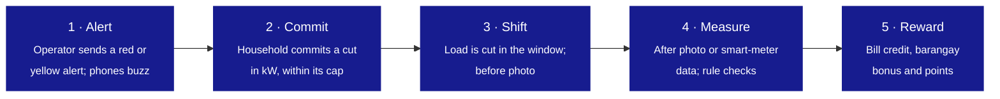
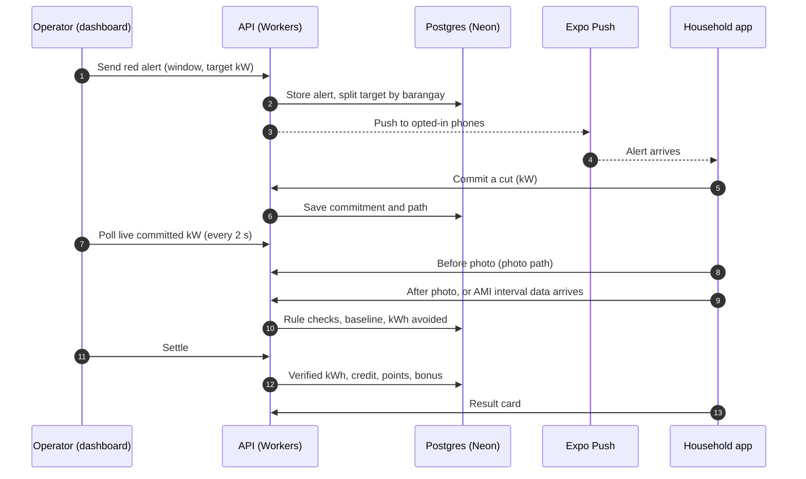
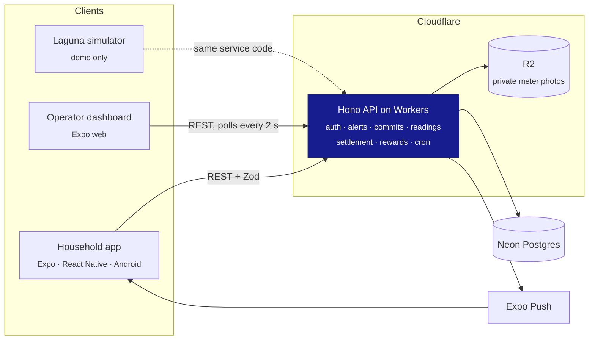

<div align="center">

<picture>
  <source media="(prefers-color-scheme: dark)" srcset="packages/assets/logo/kapitwatt-lockup-reverse.svg">
  
</picture>

### Residential demand response for Meralco

When the grid is short, households cut load together and get paid for every kilowatt-hour they can prove they saved.

[](#team)
[](#tech-stack)
[](#tech-stack)
[](#tech-stack)
[](#tech-stack)
[](#repository-layout)

[How it works](#how-it-works) · [Architecture](#architecture) · [Getting started](#getting-started) · [API](#api) · [Docs](#documentation)

</div>

> [!IMPORTANT]
> **This is a simulated pilot.** The software is real and runs end to end, but the 1,200 households, the
> NGCP alerts and the reward rates are simulated or placeholders. Team phones join as real households.
> Every placeholder number is labelled as such in the code, the apps and the pitch.

---

## Contents

- [Why KapitWatt](#why-kapitwatt)
- [How it works](#how-it-works)
- [Verification and rewards](#verification-and-rewards)
- [The Laguna pilot](#the-laguna-pilot)
- [Architecture](#architecture)
- [Tech stack](#tech-stack)
- [Repository layout](#repository-layout)
- [Getting started](#getting-started)
- [Commands](#commands)
- [API](#api)
- [Security and privacy](#security-and-privacy)
- [Testing](#testing)
- [Deployment](#deployment)
- [Contributing](#contributing)
- [Documentation](#documentation)
- [Brand](#brand)
- [Team](#team)

## Why KapitWatt

On **May 14, 2026**, NGCP declared a red alert on the Luzon grid: **12,464 MW** of supply against a
**12,877 MW** peak. Brownouts ran about two hours each, listed barangay by barangay.

Meralco's existing lever, the **Interruptible Load Program (ILP)**, pays large customers to run their own
generators during a shortfall. Households have no generator and no way to take part, even though evening
residential load, air conditioning above all, is a large share of the peak.

**KapitWatt is a household version of the ILP.** When an alert is raised, opted-in households commit to
cutting a number of kilowatts during the peak window. They are paid only for the energy Meralco can
**verify** they avoided, either from smart-meter interval data or from meter photos taken in the app. The
operator watches committed and delivered load by town and barangay in real time.

_Kapit_ is Filipino for "hold on together".

## How it works



| Step                   | The household                                                                                             | The system                                                                                            |
| ---------------------- | --------------------------------------------------------------------------------------------------------- | ----------------------------------------------------------------------------------------------------- |
| **0 · Sign-up** (once) | Opts in with consent, registers its meter type and serial. Photo households do a short rehearsal.         | Stores the registration; the rehearsal measures the baseline.                                         |
| **1 · Alert**          | Gets a push: red alert, peak window, a request to cut load.                                               | Stores the alert with sender and time, splits the target across barangays, pushes to opted-in phones. |
| **2 · Commit**         | Chooses a cut in kW (presets or a stepper).                                                               | Caps it by baseline, bill and trust score; closes commits at window start.                            |
| **3 · Shift**          | Cuts load. Photo households take a **before** photo within 15 minutes of the start.                       | Checks each photo; the barangay progress bar fills.                                                   |
| **4 · Measure**        | Photo households take an **after** photo within 30 minutes of the end. Smart-meter households do nothing. | Computes avoided kWh from the readings or the 5-minute interval data.                                 |
| **5 · Reward**         | Sees a result card: credit, barangay bonus, points, or the reason it earned nothing.                      | Settles at window end + 30 minutes; updates the leaderboard and delivered load.                       |

<details>
<summary><b>The demo loop: who talks to whom</b></summary>



</details>

## Verification and rewards

The system cannot see which appliance was switched off, and it never pays for appliance declarations. It
measures whether consumption dropped and pays for the measured drop. Every payout rests on a meter reading.

|                      | Smart meter (`ami`)                                           | Photo (`photo`, no smart meter)                                        |
| -------------------- | ------------------------------------------------------------- | ---------------------------------------------------------------------- |
| **Evidence**         | Meralco 5-minute interval data vs the household's own history | Before and after meter photos taken in the app, plus the typed reading |
| **Household effort** | None                                                          | A rehearsal at sign-up, then two photos per event                      |
| **Reward rate**      | Full (1.0)                                                    | Lower (placeholder 0.6)                                                |
| **Progress shown**   | Live reduction against baseline                               | Result after settlement                                                |
| **If it fails**      | Missing data: no payout, flagged                              | Late, missing or failed photo: no payout, no resubmission              |

**Photo checks are plain rules, with no ML:**

- in-app camera only, server-timestamped;
- fixed windows (before photo: window start to +15 min; after photo: window end to +30 min);
- the reading must rise, and by no more than the service could draw;
- GPS within 200 m of the registered address;
- a file hash rejects reused photos.

Failures go to a review queue, where a person approves or rejects them.


**Payout** (all constants are placeholders, kept in `packages/shared/src/constants.ts`):

```text
actual_kw    = (reading_after - reading_before) / hours between the readings
cut_kw       = max(0, baseline_kw - actual_kw)
cap_kw       = 2 x (bill_avg_kwh_month / 720)
paid_cut_kw  = min(cut_kw, committed_kw, cap_kw)
verified_kwh = paid_cut_kw x scheduled window hours
credit_php   = verified_kwh x 8.40 x path multiplier   (smart meter 1.0, photo 0.6)
bonus_php    = 20% of credit_php when the barangay reaches its target
points       = 100 x verified_kwh
```

**Worked example:** a photo household commits 1.0 kW for 18:00 to 20:00, with readings of 1204.3 kWh at
18:04 and 1206.6 kWh at 20:10.

- That's 1.1 kW measured against a 1.9 kW baseline: a **0.8 kW** cut, so **1.6 kWh** verified.
- It earns **PHP 8.06** credit, plus **PHP 1.61** if its barangay hits target, plus **160 points**.
- The same cut on a smart meter earns **PHP 13.44**.

This example is a unit test, and it is reproduced through the live API in the end-to-end test.

## The Laguna pilot

Seven Meralco franchise towns in Laguna: **Santa Cruz** (hub), Pila, Victoria, Nagcarlan, Liliw, Majayjay
and Magdalena. That's 21 sampled barangays (real PSA names; the choice of three per town is the team's own)
and **1,200 simulated households**, plus team phones as real households in Santa Cruz.

| Simulation parameter            | Default (an assumption)       |
| ------------------------------- | ----------------------------- |
| Participation                   | 60%, adjustable 20% to 80%    |
| Follow-through                  | 80% of committed kW delivered |
| Path mix                        | 15% smart meter, 85% photo    |
| Photo completion                | 90%                           |
| Cut per participating household | 1 kW                          |

**What a default run produces, through the real API** (seeded, so the same every time):

|                         | Plan     | Measured |
| ----------------------- | -------- | -------- |
| Committed               | 720 kW   | 719 kW   |
| Delivered               | ≈ 527 kW | 523.6 kW |
| Against a 600 kW target | ≈ 88%    | 87%      |

The shortfall is the point: every missed photo is verified kW lost, which smart meters would recover.

## Architecture



**Rules the codebase holds to:**

1. **Apps never import each other.** They talk through the API and `@kapitwatt/shared`.
2. **The simulator never inserts rows.** It drives the same service functions real households use, through
   a `SimPort`, and only ever touches rows flagged `is_simulated`.
3. **Only the API and `packages/db` touch Postgres.** The driver lives in `packages/db` alone.
4. **Push is sent only from the API.**
5. **One schema everywhere.** Request and response shapes are Zod schemas in `packages/shared`; the API
   validates with them and the apps type their calls with them.
6. **Reward and timing numbers live in one file,** `packages/shared/src/constants.ts`.
7. **Server time for anything that affects a payout,** never the phone clock.

## Tech stack

| Layer         | Choice                                                                        |
| ------------- | ----------------------------------------------------------------------------- |
| Language      | TypeScript (strict) everywhere                                                |
| Monorepo      | pnpm workspaces, hoisted node-linker, one pinned React / React Native         |
| Household app | Expo SDK 58 + React Native, Expo Router, TanStack Query; Android APK via EAS  |
| Dashboard     | Expo web (Expo Router), react-native-web                                      |
| API           | Hono on Cloudflare Workers, Workers Rate Limiting, Cron Triggers              |
| Database      | Neon Postgres via `@neondatabase/serverless` (HTTP), plain SQL migrations     |
| Photo storage | Cloudflare R2, private bucket, 30-day retention                               |
| Push          | Expo Push Service                                                             |
| Validation    | Zod, shared by the API and both apps                                          |
| Secrets       | Doppler (project `kapitwatt`)                                                 |
| Design system | `@kapitwatt/tokens`, `styles`, `ui`, `hooks`, `icons` (Phosphor), Albert Sans |
| Tests         | Vitest; API end-to-end and live smoke scripts                                 |

## Repository layout

```text
apps/
  mobile/       Household app (Expo + React Native)
  dashboard/    Operator dashboard (Expo web)
  api/          API (Hono on Cloudflare Workers)
packages/
  shared/       Zod schemas, types, constants, baseline / payout / check math
  db/           Postgres migrations and query helpers
  sim/          Laguna seed data and the event runner (demo only)
  tokens/       Design tokens: colour roles, type scale, spacing, motion
  styles/       Theme as React Native styles, ThemeProvider, brand fonts
  ui/           UI primitives for both apps
  hooks/        Shared React hooks: theme, size class, countdown, fonts
  icons/        Curated Phosphor icon set behind one <Icon> component
  assets/       Logo, app icons, mascot, Albert Sans
  config/       Shared tsconfig
docs/           The full plan (source of truth), PRD, SRS, MVP
```

## Getting started

### Prerequisites

- **Node.js 22+** and **pnpm 12** (`packageManager` pins the exact version)
- **Doppler CLI**: every secret and env var lives in Doppler, project `kapitwatt`. Nothing is kept in
  `.env` files.
- Optional: the **Neon CLI** for database branches, and **Expo Go** or a dev build for the household app

### Setup

```bash
pnpm install
doppler login        # once per machine; add --scope <repo path> if you use other Doppler workplaces
doppler setup        # once; doppler.yaml already names project kapitwatt, config dev
```

> [!NOTE]
> Do **not** create `apps/api/.dev.vars`. The API reads its secrets from Doppler through the process
> environment, and a `.dev.vars` file would silently take precedence.

### Run

```bash
pnpm dev:api          # API on http://localhost:8787
pnpm dev:dashboard    # Dashboard on http://localhost:8081
pnpm dev:mobile       # Household app (Expo Go or a dev build)
```

The apps read `EXPO_PUBLIC_API_URL` from Doppler. It points at the live API by default; set it to your
machine's LAN address to use a local API from a phone. The dashboard has a browser-only fixture mode
(`EXPO_PUBLIC_FIXTURES=1`) that runs the real simulator in memory.

## Commands

| Command                                   | What it does                                                 |
| ----------------------------------------- | ------------------------------------------------------------ |
| `pnpm typecheck`                          | `tsc --noEmit` in every package                              |
| `pnpm test`                               | Vitest in every package that has tests                       |
| `pnpm format`                             | Prettier (single quotes, 100 columns)                        |
| `pnpm build`                              | Typecheck, bundle the API (dry run), export the dashboard    |
| `pnpm db:migrate`                         | Apply `packages/db/migrations/*.sql` (direct connection)     |
| `pnpm db:seed`                            | Load the 21 pilot barangays (safe to re-run)                 |
| `pnpm db:smoke`                           | Write, read back and delete one row through the app's driver |
| `pnpm --filter @kapitwatt/api e2e`        | End-to-end test of a running API against the database        |
| `pnpm --filter @kapitwatt/api smoke:live` | Read-only checks of the deployed API                         |
| `pnpm deploy:api`                         | Guarded deploy of the API, from `main`                       |

## API

Base URL: `https://kapitwatt-api.dheyn-main.workers.dev`. All shapes are Zod schemas in
`packages/shared/src/schemas` (`requests.ts`, `responses.ts`). The full requirement list is in the
[SRS](./docs/srs/SRS.md).

| Area           | Endpoints                                                                                                      | Caller                   |
| -------------- | -------------------------------------------------------------------------------------------------------------- | ------------------------ |
| Health         | `GET /health`, `GET /health/db`                                                                                | anyone                   |
| Households     | `POST /auth/register`, `GET /auth/me`, `PUT /auth/push-token`                                                  | household                |
| Barangays      | `GET /barangays`, `GET /barangays/leaderboard`                                                                 | anyone                   |
| Alerts         | `POST /alerts`, `GET /alerts`, `PUT /alerts/:id/targets`, `POST /alerts/:id/cancel`, `POST /alerts/:id/settle` | operator                 |
| Alerts (read)  | `GET /alerts/active`, `GET /alerts/:id`, `GET /alerts/:id/totals`                                              | anyone                   |
| Measure (demo) | `POST /alerts/:id/fast-forward` (`window_start` / `window_end`)                                                | operator, demo only      |
| Commitments    | `POST /commitments`, `GET /commitments/by-alert/:alertId`, `GET /commitments/history`                          | household                |
| Readings       | `POST /readings` (multipart photo)                                                                             | household                |
| Review         | `GET /readings/flagged`, `POST /readings/:id/review`, `GET /readings/:id/photo`                                | operator                 |
| Rewards        | `GET /rewards/by-alert/:alertId`, `GET /rewards/summary`                                                       | household                |
| Simulator      | `POST /sim/seed`, `POST /sim/run`, `POST /sim/reset`, `GET /sim/status`                                        | simulator key, demo only |

**Auth:**

- **Households** send `Authorization: Bearer kw_…`. The token is issued once at sign-up and only its
  SHA-256 hash is stored.
- **The operator** sends `x-operator-key`.
- **The simulator** sends `x-sim-key`. Its routes do not exist outside the demo environment.

**Errors** always use one envelope, `{ "error": { "code", "message", "requestId", "issues?" } }`, with
stable codes such as `window_closed`, `above_cap`, `deadline_passed` and `duplicate_photo`.

**A cron runs every minute.** It sends scheduled alerts and reminder pushes (15 minutes before the window,
then before- and after-photo reminders), and settles alerts at window end + 30 minutes. Settlement is
atomic and idempotent: running it twice never pays twice.

## Security and privacy

KapitWatt handles personal data under the **Data Privacy Act of 2012**: meter photos, readings and
locations.

- **Consent:** opt-in consent on the sign-up screen, with its time recorded by the server. Only opted-in
  households get alerts, and every alert is logged with its sender and time.
- **Photos:** kept in a private R2 bucket under random keys. There are no public URLs, operators view them
  through an authenticated route, and they are deleted after 30 days.
- **Aggregates only:** totals and the leaderboard report per barangay and never expose a household.
- **Credentials:**
  - household tokens are stored only as hashes;
  - shared keys are compared in constant time;
  - weak or default keys switch their routes off.
- **Request hardening:** strict CORS allowlist, security headers, `Cache-Control: no-store`, body limits,
  per-route rate limits, and validated inputs including UUID path parameters.
- **SQL and logs:** parameterised SQL only. Access logs record route, status and timing, never bodies,
  tokens, readings or GPS.
- **Simulator isolation:** every simulator query is limited to rows flagged `is_simulated`.

## Testing

- **Unit tests (Vitest):**
  - the payout and baseline math against the plan's worked example;
  - settlement rules, photo checks, commit caps and trust;
  - the simulator's expected numbers;
  - the design tokens, including colour contrast;
  - the API's security behaviour (headers, CORS, auth, body limits, error envelope).
- **End-to-end** (`apps/api/scripts/e2e.ts`): drives a running API and the real database through the whole
  demo loop in **155 checks**:
  - sign-up, alerts with real Expo push;
  - real and simulated commitments;
  - photos, Measure, settlement and result cards;
  - review, cancel, scheduled sends, reminders and trust.

  It refuses to start if simulated data already exists, and deletes everything it creates.

- **Live smoke test** (`smoke:live`): 18 read-only checks of a deployed API.

CI runs `pnpm typecheck` and `pnpm test` on every pull request into `dev` and `main`.

## Deployment

| Target            | How                                                                                                                                                                                                                                                           |
| ----------------- | ------------------------------------------------------------------------------------------------------------------------------------------------------------------------------------------------------------------------------------------------------------- |
| **API**           | `pnpm deploy:api` from `main` with a clean tree. A preflight checks the branch, the Doppler secrets, the Cloudflare login and the R2 bucket, then `wrangler deploy --secrets-file` uploads the version and its secrets together. Run `smoke:live` afterwards. |
| **Dashboard**     | `pnpm --filter @kapitwatt/dashboard build` (Expo web export), served from Cloudflare Pages. Add its URL to `ALLOWED_ORIGINS` in `apps/api/wrangler.jsonc`.                                                                                                    |
| **Household app** | EAS build as an Android APK; Expo Go during development. Push needs real phones.                                                                                                                                                                              |
| **Database**      | New numbered files in `packages/db/migrations`, applied with `pnpm db:migrate`. Never edit an applied migration.                                                                                                                                              |

## Contributing

- **Branching:** feature branch → `dev` → `main`.
  - Branch from the latest `dev` as `<area>/<topic>`, for example `api/settlement` or `mobile/commit-screen`.
  - Open a pull request into `dev` and squash-merge it once CI passes.
  - `dev` is promoted to `main` by a pull request merged with a **merge commit**. `main` is what gets
    deployed and demoed.
- **Commits:** small, prefixed with the area (`api: settlement`, `mobile: commit screen`).
- **Ownership:** one owner per folder (see below). Keep changes inside your folder; announce changes to
  `packages/shared`, since everyone imports it.

The architecture rules, domain rules, priorities and conventions are in [CLAUDE.md](./CLAUDE.md). Read it
before you start.

## Documentation

| Document                                          | What it answers                                                  |
| ------------------------------------------------- | ---------------------------------------------------------------- |
| [Full plan (PDF)](./docs/KapitWatt_Full_Plan.pdf) | The source of truth for the idea, scope and demo                 |
| [PRD](./docs/prd/PRD.md)                          | What we are building, for whom, and why                          |
| [SRS](./docs/srs/SRS.md)                          | What the software must do, requirement by requirement            |
| [MVP](./docs/mvp/MVP.md)                          | What must work in the demo, acceptance criteria, the demo script |
| [Brand assets](./packages/assets/README.md)       | Logo versions, clear space, app icons, the mascot, fonts         |

## Brand

The logo is a firefly (_alitaptap_) with a custom **KAPITWATT** wordmark set in Albert Sans. It uses a
single colour: **Grid Indigo `#171C8F`** on light grounds, white on indigo. Use the files in
[`packages/assets/logo`](./packages/assets/logo) as they are: never recolour, outline or add effects. The
mascot poses in [`packages/assets/mascot`](./packages/assets/mascot) are for empty states and result cards,
not a replacement for the logo.

## Team

Built by **team CodeBearers** for the **IDOL Hackathon 2026**, in a 24-hour build.

| Role                  | Owns                                                       |
| --------------------- | ---------------------------------------------------------- |
| Household app         | `apps/mobile`, including the camera and photo flow         |
| Operator dashboard    | `apps/dashboard`                                           |
| API and database      | `apps/api` and `packages/db`: readings, checks, settlement |
| Simulator and math    | `packages/sim` and the math in `packages/shared`           |
| Pitch and integration | The pitch, the demo script, integration testing            |

**Data sources:**

- the May 14, 2026 red-alert figures (Philstar);
- ILP payment rules (ERC Resolution 08 S. 2013, Meralco);
- smart-meter rollout figures (Power Philippines, BusinessWorld, Daily Tribune, Insider PH);
- barangay names from the PSA's PSGC list.

Households, alerts and reward rates in this repository are simulated.

**Status:** a hackathon prototype. No open-source licence has been chosen yet, so all rights are reserved by
the team.
